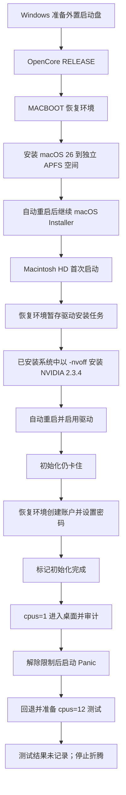

# 拯救者 R9000P ADR10 黑苹果折腾记录

**Ryzen 9 8945HX · RTX 5060 Laptop · macOS Tahoe 26 · OpenCore · NullMoth**

> 最终状态：2026-10-24，我停止折腾，删除了 macOS，安装空间已经还给 Windows 的 D 盘。
>
> 这次确实进过桌面，也运行过应用和显卡测试。但没有完成可日常使用的多核、外设和长期稳定性验收。这个仓库记录我走过的流程、遇到的问题和证据，不把“进桌面”写成“完美黑苹果”。

## 我最后做到了哪一步

最开始只是想给自己的 R9000P 装 macOS 26，后来经历了恢复入口不出现、早期内核崩溃、PCI 卡住、OpenCore 选择后等几分钟、U 盘读取异常、黑屏只有鼠标、国家选择转圈、显卡安装状态不明确等问题。

最后通过恢复环境创建本地管理员、跳过初始化向导，进入了 macOS 桌面。之后在 macOS 中安装了 Codex，生成了一份系统审计报告。该报告记录了四个 NVIDIA 2.3.4 驱动加载，以及 Metal 计算、渲染和部分硬件视频编解码测试通过。

卡住我的最后一道坎是多核和系统完整性：能进入桌面时仍有 `cpus=1`，实际只有一个在线逻辑处理器。去掉这个限制后，下一次启动出现 Kernel Panic。后来又准备了 `cpus=12` 测试，但我没有留下可确认的测试结果，随后决定停止。

反复重启、等待、切回 Windows 查日志消耗了太多时间。对我来说，已经证明“有机会跑起来”，但继续把它修到日用状态的成本太高。

## 先看结论

| 项目 | 本机实际结果 |
|---|---|
| OpenCore 启动 | 能启动；后期使用匹配的 1.0.9 RELEASE 文件 |
| macOS 恢复环境 | 能进入；曾分别使用 15 和 26 恢复环境做对照 |
| macOS 15 日用安装 | 没有完成；不能把恢复环境对照算作 15 系统成功安装 |
| macOS 26 安装 | 已安装到内部 SSD 的独立 APFS 空间 |
| 初始化向导 | 正常路径卡在国家/地区选择后；最终绕过 |
| macOS 桌面 | 曾进入，可使用终端并安装应用 |
| RTX 5060 Laptop | macOS 端审计记录四个 2.3.4 kext 加载、Metal 实测通过；不等于所有应用兼容 |
| CPU | 进入桌面时限制为 `cpus=1`；解除限制后发生启动 Panic |
| `cpus=12` | 已配置，结果未记录，不算成功也不算已证实失败 |
| 键盘/触控板 | 后期可用；没有完成全部按键与手势验收 |
| 有线网络 | macOS 端审计记录 1Gbps 链路可用 |
| Wi-Fi / 蓝牙 / 内置音频 / 背光 | 没有修到可正常验收的状态 |
| 最终选择 | 删除 macOS，空间还给 D 盘 |

## 这台机器的范围

| 硬件 | 配置 |
|---|---|
| 机型 | 联想拯救者 R9000P ADR10，机器类型 83LV |
| CPU | AMD Ryzen 9 8945HX，16 核 / 32 线程，Zen 4 |
| GPU | NVIDIA GeForce RTX 5060 Laptop，8GB，PCI ID `10DE:2D59` |
| 内存 | 32GB，固件报告 5200MHz |
| 内屏 | 2560×1600；macOS 审计记录 240Hz、1280×800 HiDPI |
| Wi-Fi | MediaTek MT7925，`14C3:7925` |
| 有线网卡 | Realtek RTL8125，`10EC:8125` |
| SSD | UMIS RPJYJ1T24MML1AWY，约 1TB NVMe |
| 原系统 | Windows 11 |

同名 R9000P 的不同年份、CPU、显卡和面板并不相同。尤其是 **7945HX + RTX 4060 的 R9000P 2023**，只能作为相近案例，不能直接把它的 EFI 当作 ADR10 的答案。

## 从哪里开始读

| 文档 | 内容 |
|---|---|
| [完整安装流程](docs/02-installation.md) | 材料准备、启动盘目录、双阶段安装、驱动、账户、验收 |
| [故障与解决记录](docs/03-troubleshooting.md) | 每个症状的证据、处理、结果，以及仍不能确定的事 |
| [CPU 与多核专题](docs/04-cpu-and-panic.md) | `cpus`、物理核心补丁、SMBIOS、Panic 和回退 |
| [硬件与配置](docs/00-hardware-and-config.md) | 本机配置、版本、关键参数、恢复和已安装驱动两种配置 |
| [时间线](docs/01-timeline.md) | 从第一次启动到停止折腾，按阶段还原 |
| [驱动与账户辅助脚本说明](scripts/README.md) | 历史辅助脚本、准确目录、版本约束和执行顺序 |
| [验证与排障方法](docs/05-validation-and-lessons.md) | 怎么判断真正安装、真正加载、真正可用，以及如何减少无效重启 |
| [资料与相近案例](docs/06-references.md) | 固定版本文档、上游 Issue、相近机型后续反馈 |
| [证据目录](evidence/README.md) | 脱敏审计报告、日志摘录和证据边界 |
| [历史配置与差异](configs/README.md) | 单核桌面基线、解除限制、cpus=12 和恢复环境参考 |
| [EFI 与附件](artifacts/README.md) | 完整 EFI 候选附件的范围、文件清单和发布状态 |

## 实际走通的路径

这是事后整理的路线图，不表示其中每个步骤在第一次就成功，也不表示其他机器需要相同的补丁。

## 这个仓库提供什么

提供有版本和上下文的配置记录、安装顺序、错误原文、脱敏日志，以及本次实际用过的辅助脚本。Git 文件中收录 4 份脱敏配置和 3 份变更差异；完整 EFI 保留本地，公开具体组件版本、实际下载入口、源码与许可说明，详见 [附件说明](artifacts/README.md)。**不附 macOS 恢复镜像、NVIDIA 安装包或个人 SMBIOS 身份。** 配置需要按自己的硬件核对，各组件来源与分发说明见 [第三方说明](THIRD-PARTY-NOTICES.md)。

脚本是本次经历的辅助材料，不是通用一键安装器；它们会在用户明确运行时修改所选 macOS 的驱动或账户，使用前请读对应说明。文档中的样例盘符、卷名和数值也不是设备身份。

截至整理日期 **2026-10-24**，我没有继续验证更新版本，也没有得出“这个型号永远不可能成功”的结论。后人如果解决了多核、音频、无线或背光，欢迎带着硬件版本、真实日志和复现步骤补充。

## 记录方式

过程使用了 Windows 和 macOS 两侧的 Codex 辅助诊断。软件给出的方案、脚本语法检查通过、`ocvalidate` 通过，都不自动等于实机问题已经解决。本文按原始记录重新区分了实机观察、报告中的测试结果和未验证假设。

文档为中文经验稿；公开仓库发布前由作者审核。第三方项目、软件和代码遵循各自许可，本仓库不会改变上游的授权条件。
